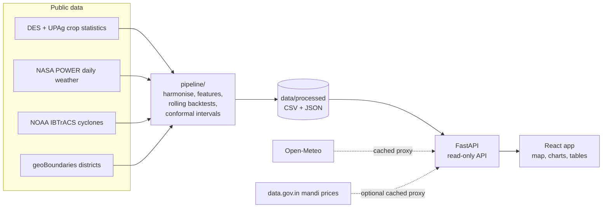

# KrushiMitra AI

[](https://github.com/YashPandit09/KrushiMitraAi/actions/workflows/ci.yml)
[](https://github.com/YashPandit09/KrushiMitraAi/actions/workflows/codeql.yml)
[](LICENSE)

**Open, district-level Kharif rice yield forecasts for all 30 districts of Odisha - built on official statistics and
public weather data, evaluated out of sample, and shipped with calibrated uncertainty.**

KrushiMitra AI forecasts each district's Kharif (autumn + winter) rice yield during the season, from the end of July
to the end of November. Every forecast comes with an 80% and a 90% range and a breakdown of what moved it (rainfall,
soil moisture, heat, dry spells, cyclones). It began as our Smart India Hackathon 2025 entry for problem statement
SIH25044 (Government of Odisha) and was rebuilt from scratch as a reproducible, deployable system - see
[CREDITS.md](CREDITS.md).

## What is inside

- **A data pipeline** that harmonises 27 Kharif seasons (1998-2024) of official district statistics (DES + UPAg) with
  daily NASA POWER weather and NOAA IBTrACS cyclone tracks. It reconciles three different district-spelling
  systems, and detects and corrects a precipitation-scaling quirk in the POWER API. Each correction is logged and
  backed by a hard physical sanity check.
- **A forecasting model**: robust per-district trend x (1 + weather adjustment), with ridge, gradient-boosting and
  ensemble candidates, chosen per issue date by their recent out-of-sample record.
- **Honest evaluation**: rolling-origin backtests (each season predicted only from earlier seasons), baselines,
  district- and state-level skill, interval coverage, and a disclosed protocol history - see
  [docs/MODEL_CARD.md](docs/MODEL_CARD.md).
- **A web app** (FastAPI + React) with a district map, per-district forecasts and history, season rainfall vs
  normal, a live 7-day weather forecast and (optionally) today's mandi prices. Accessible charts with table views
  and light/dark themes.
- **Production hygiene**: one-command Docker deployment, CI (tests, lint, type-checks, container smoke test),
  CodeQL, secret scanning, dependency audits, SBOM-attested images and a hardened, non-root container.

## Key findings (2015-2024 out-of-sample backtests)

| Forecast issued after | District error (MAPE) | State error (MAPE) | Skill vs trend, district / state | 80% range coverage | Used now |
|---|---|---|---|---|---|
| end of July-September | 30-31% | 18-21% | slightly negative | 88-90% | district trend |
| end of October-November | 27% | 16-17% | **+0.04 / +0.10** | 88% | weather-aware ensemble |

- Odisha's official district yields swing by roughly a quarter from season to season, so district-level forecasts
  are hard and their ranges are wide. The model says so instead of hiding it.
- Weather known by the end of September does **not** beat the district trend out of sample, so the system falls
  back to the trend for early issue dates. Once late-season rain and cyclones are known (October-November), weather
  adds measurable skill - about 10% lower squared error for the state total.
- The conformal ranges are well calibrated (slightly conservative).
- Exact, regenerated numbers: [docs/MODEL_CARD.md](docs/MODEL_CARD.md) and the app's *How it works* page.

## Quick start

### Docker (recommended)

```bash
git clone https://github.com/YashPandit09/KrushiMitraAi.git
cd KrushiMitraAi
docker compose up --build
```

Open <http://localhost:8000>. API docs: <http://localhost:8000/api/docs>.

A pre-built image is also published for every commit to `main`:

```bash
docker run --rm -p 8000:8000 ghcr.io/yashpandit09/krushimitra-ai:latest
```

### Without Docker (Python 3.12 + Node 22)

```bash
python -m venv .venv && source .venv/bin/activate     # Windows: .venv\Scripts\activate
pip install -r backend/requirements.txt
cd frontend && npm ci && npm run build && cd ..
uvicorn backend.app.main:create_app --factory --port 8000
```

For frontend development, run the API as above and `cd frontend && npm run dev` (http://localhost:5173, proxies
`/api` to port 8000).

## Deploy

[](https://render.com/deploy?repo=https://github.com/YashPandit09/KrushiMitraAi)

The image runs on any container host (Render, Fly.io, Railway, Google Cloud Run, a VPS) and listens on `$PORT`
(default 8000). The app needs no database and no secrets. Optional settings:

| Variable | Purpose | Default |
|---|---|---|
| `DATA_GOV_IN_API_KEY` | Enables live mandi prices (free key from data.gov.in) | unset (feature off) |
| `FORWARDED_ALLOW_IPS` | Proxies trusted to set `X-Forwarded-For` (`*` on Render) | `127.0.0.1` |
| `CORS_ORIGINS` | Extra origins allowed to call the API | empty (same-origin) |
| `LIVE_RATE_LIMIT_PER_MINUTE` | Per-IP limit for the live endpoints | `60` |

## Reproduce the science

```bash
pip install -r pipeline/requirements.txt
python -m pipeline all          # download public data, rebuild features, backtest every model, forecast
python -m pipeline all --refresh-weather   # later in the season: fetch the newest weather and update forecasts
```

Everything in `data/processed/` and `docs/MODEL_CARD.md` is regenerated. A scheduled GitHub Action does this on the
5th of every month from July to December. It opens a pull request with the new forecasts and a summary table; once a
maintainer merges it, a new image is published.

## How it works



```
pipeline/   data download, harmonisation, features, models, evaluation, model-card report (+ tests)
backend/    FastAPI app: read-only data API, live weather/price proxies, security middleware (+ tests)
frontend/   React + TypeScript (Vite); hand-built accessible SVG charts and a d3-geo district map
data/       processed, versioned artefacts the app serves (raw downloads are git-ignored)
docs/       generated model card
```

## API

Interactive documentation is served at `/api/docs`. Main endpoints:

| Endpoint | Returns |
|---|---|
| `GET /api/meta` | Data freshness, available seasons and issue dates, enabled features |
| `GET /api/forecasts?year=2026&lead=Sep` | All districts for one season and issue date, plus the state figure |
| `GET /api/forecasts/{district}` | Every current forecast for a district, with drivers and nearby cyclones |
| `GET /api/backtest/{district}?lead=Oct` | Past out-of-sample forecasts vs official yields |
| `GET /api/districts/{district}/yields?crop=Rice&season=Winter` | Official statistics for any crop |
| `GET /api/model-card` | Evaluation results and protocol |
| `GET /api/live/weather/{district}` | 7-day forecast (Open-Meteo, cached) |

## Security

No accounts and no personal data. The only optional secret stays on the server. Outbound calls go only to fixed
hosts with allow-listed parameters, and the app sets a strict CSP. The container runs as non-root, and CI scans for
secrets and vulnerable dependencies. Details and how to report a vulnerability: [SECURITY.md](SECURITY.md).

## Credits and licence

Built on the work of our Smart India Hackathon 2025 team (problem statement SIH25044, Government of Odisha). The
original prototype is [Shaunakrane914/Yield-Ai](https://github.com/Shaunakrane914/Yield-Ai); full acknowledgements
and data citations are in [CREDITS.md](CREDITS.md).

Code: [MIT](LICENSE). Data files keep their source licences ([data/README.md](data/README.md)). Forecasts are
statistical estimates, not official statistics or agronomic advice.
